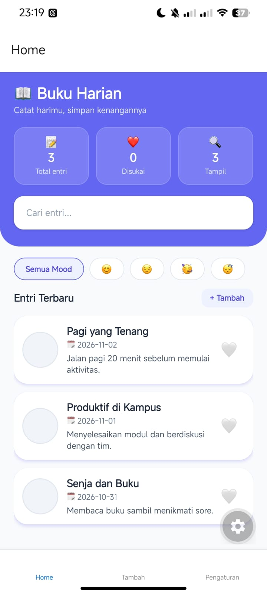

# Diary App (diary-app6)

Aplikasi buku harian berbasis seluler (Mobile Diary App) yang dikembangkan menggunakan React Native dan Expo Router. Aplikasi ini dirancang untuk memudahkan pengguna dalam mencatat keseharian, dilengkapi dengan fitur pencarian interaktif, filter berdasarkan mood, pengelolaan catatan favorit yang tersinkronisasi, serta antarmuka modern dengan header ungu melengkung dan kartu statistik.

## Identitas 
* **Nama:** Nurrifani Herdiyanti
* **NIM:** 2430511016
* **Kelas:** Teknik Informatika 5A
---

## Cara Menjalankan Project

1. Buka terminal atau command prompt pada direktori tempat folder proyek **diary-app6** berada.
2. Instal seluruh dependensi yang dibutuhkan dengan menjalankan perintah `npm install`. (Pastikan folder `node_modules` tidak disertakan apabila Anda mengompres folder proyek untuk pengumpulan tugas).
3. Jalankan aplikasi menggunakan Expo dengan mengetikkan perintah `npx expo start` di terminal.
4. Buka aplikasi di perangkat Anda dengan memindai QR Code yang muncul menggunakan aplikasi Expo Go pada ponsel (seperti Redmi Note 14), atau jalankan pada emulator dengan menekan tombol `a` untuk Android atau `i` untuk iOS.

---

## Penjelasan Hooks yang Digunakan

Dalam pengembangan aplikasi diary-app6 ini, terdapat lima Hooks utama React yang diterapkan untuk mengatur fungsionalitas dan performa aplikasi:

1. **useState**: Digunakan untuk menyimpan dan mengelola state lokal secara reaktif di dalam komponen, seperti menangani nilai ketikan input pencarian (query), status pilihan mood (selectedMood), serta pengaturan preferensi aplikasi.
2. **useEffect**: Digunakan untuk menerapkan teknik debounce pada fitur pencarian dengan memanfaatkan fungsi penundaan setTimeout. Hook ini memastikan proses penyaringan data tidak berjalan secara instan pada setiap ketukan tombol, sehingga performa aplikasi tetap optimal.
3. **useMemo**: Digunakan untuk melakukan memoization pada hasil kalkulasi data yang berat, seperti menyaring daftar entri berdasarkan pencarian dan mood (filteredEntries) serta menyaring catatan favorit (useLikedEntries). Hal ini mencegah komputasi berulang yang tidak perlu pada setiap siklus render.
4. **useCallback**: Digunakan untuk membungkus fungsi-fungsi aksi (seperti navigasi rute dan reset filter) agar referensi fungsinya tetap stabil dan tidak dibuat ulang secara terus-menerus saat diteruskan sebagai props ke komponen anak.
5. **useRef**: Digunakan untuk mengambil referensi langsung ke instans komponen native (seperti elemen TextInput pada kolom pencarian), yang memungkinkan aplikasi memicu fungsi focus() secara otomatis saat tombol hapus atau reset ditekan.

---

## Tangkapan Layar (Screenshot) Fitur

